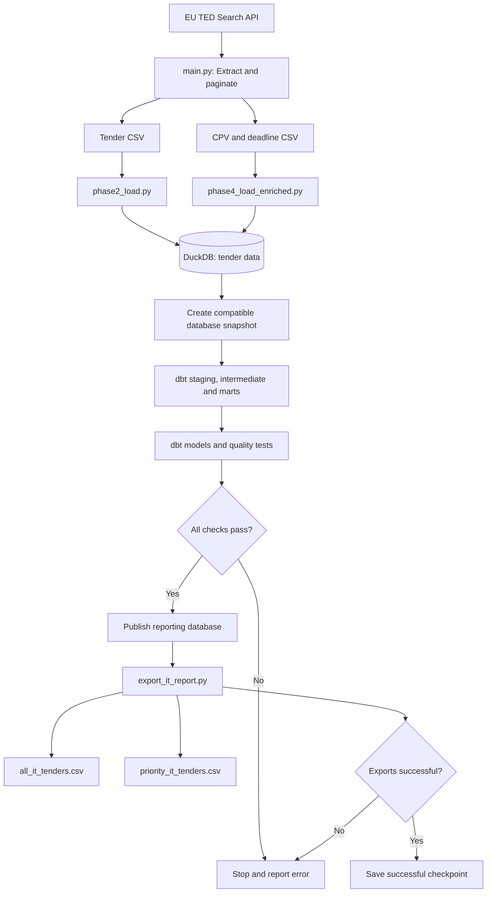

# EU Tender Intelligence — System Architecture

This diagram shows the automated flow from public EU procurement data to validated IT tender reports.



## Data Processing

1. Python retrieves public procurement notices from TED.
2. DuckDB stores tender records and enrichment data.
3. A compatible database snapshot is prepared for dbt.
4. dbt transforms the data and runs automated tests.
5. The validated reporting database is published.
6. Python exports IT opportunity reports.
7. The checkpoint is updated after successful execution.

## Reliability Considerations

- Tender records are compared with existing records to reduce unnecessary updates.
- dbt tests check selected integrity and business rules.
- The published database is updated only after a successful dbt build.
- Reports require manual verification of tender availability and lot-level deadlines.
- Database and CSV publication are not yet fully transactional.
```